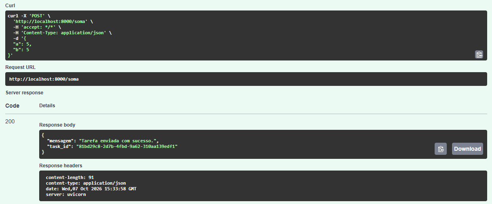
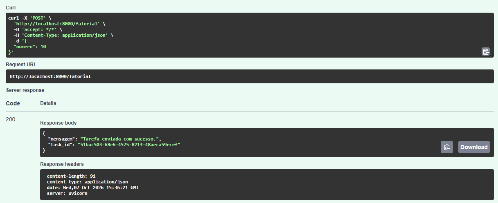
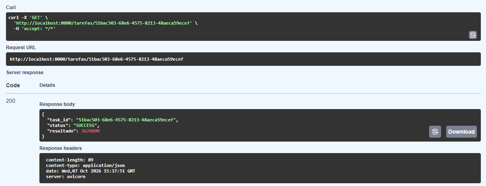
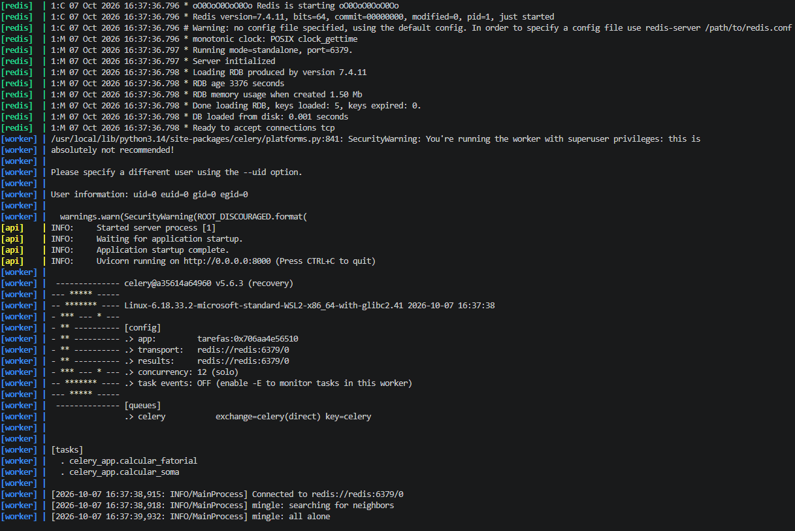
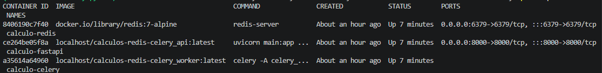

# API de Cálculos Realizados de Forma Assíncrona com FastAPI, Celery e Redis

## Descrição

Este projeto demonstra a utilização de tarefas assíncronas em uma API desenvolvida com FastAPI, utilizando Celery como fila de processamento em background e Redis como broker de mensagens e backend de resultados.

Foram implementadas duas tarefas:

- Soma de dois números;
- Fatorial.

As tarefas são processadas por um worker Celery, permitindo que a API responda imediatamente sem bloquear a requisição enquanto o processamento é executado em segundo plano.

## Arquitetura

```text
Cliente --> FastAPI --> Redis (Broker/Backend) --> Celery Worker
```

Fluxo:

1. O cliente envia uma requisição para a API.
2. A API envia uma tarefa para o Redis.
3. A API retorna imediatamente um `task_id`.
4. O Worker Celery consome a tarefa.
5. O resultado é armazenado no Redis.
6. O cliente consulta posteriormente o status e o resultado da tarefa.

## Tecnologias Utilizadas

- Python 3.14
- FastAPI
- Celery
- Redis
- Poetry
- Podman
- Podman Compose
- Uvicorn

## Estrutura do Projeto

```text
calculos-redis-celery/
│
├── celery_app.py
├── main.py
├── Dockerfile
├── docker-compose.yml
├── pyproject.toml
├── poetry.lock
├── README.md
├── .gitignore
│
└── public/
```

## Instalação

Clone o projeto:

```bash
git clone https://github.com/tayanibritto/calculos-redis-celery.git
```

Instale as dependências:

```bash
poetry install
```

## Executando com Podman Compose

O comando abaixo inicia simultaneamente o Redis, a API e o Celery Worker.

```bash
podman-compose up --build
```

Os seguintes containers serão criados:

- Redis
- FastAPI
- Celery Worker

## Acessando a documentação

Após iniciar os containers, acesse:

```text
http://localhost:8000/docs
```

## Endpoints

### POST /soma

Dispara uma tarefa assíncrona para calcular a soma de dois números.

Exemplo:



### POST /fatorial

Dispara uma tarefa assíncrona para calcular o fatorial de um número.

Exemplo:



### GET /tarefas/{task_id}

Consulta o status e o resultado de uma tarefa.

Exemplo (fatorial de 10):



## Implementação das Tarefas

### calcular_soma

- Recebe dois números.
- Simula processamento demorado utilizando `time.sleep(5)`.
- Retorna a soma dos valores.

### calcular_fatorial

- Recebe um número inteiro.
- Simula processamento demorado utilizando `time.sleep(10)`.
- Calcula o fatorial de forma iterativa.
- Evita estouro de pilha por não utilizar recursão.

## Inicialização do Compose

Além dos endpoints funcionando, também vale evidenciar a inicialização do Compose e o funcionamento dos containers em conjunto:

Aqui, é possível verificar o Redis, a API e o Celery funcionando.

1. Resultado de `podman-compose up --build`:



2. Resultado de `podman ps`:

